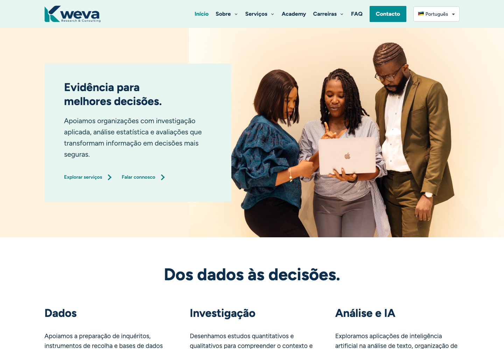
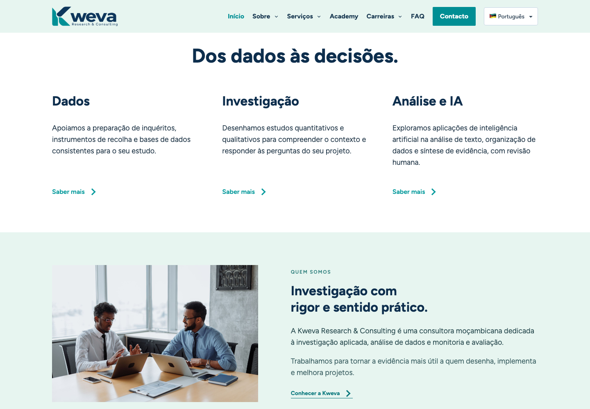
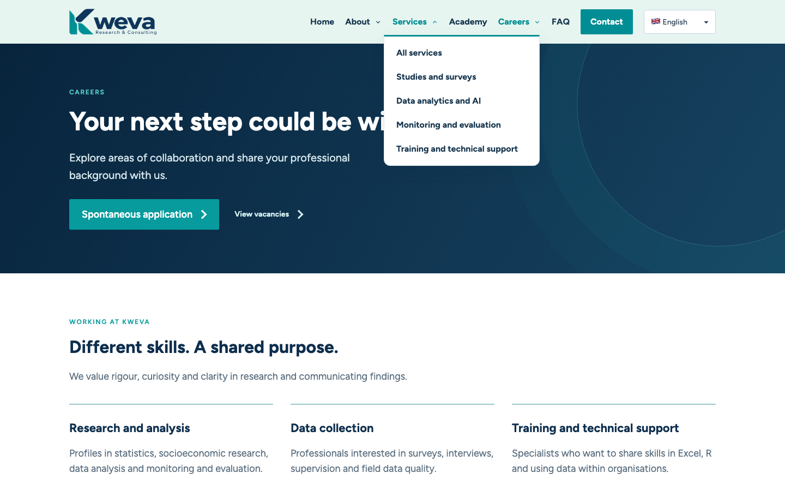
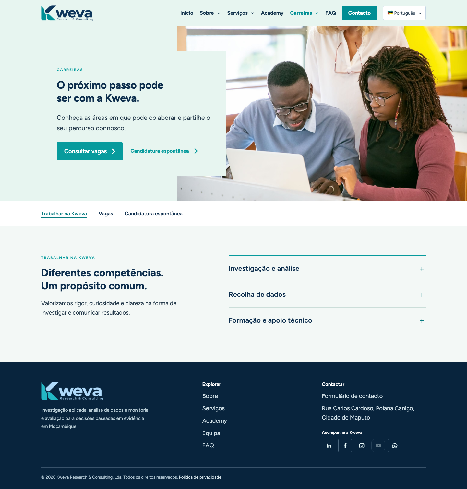
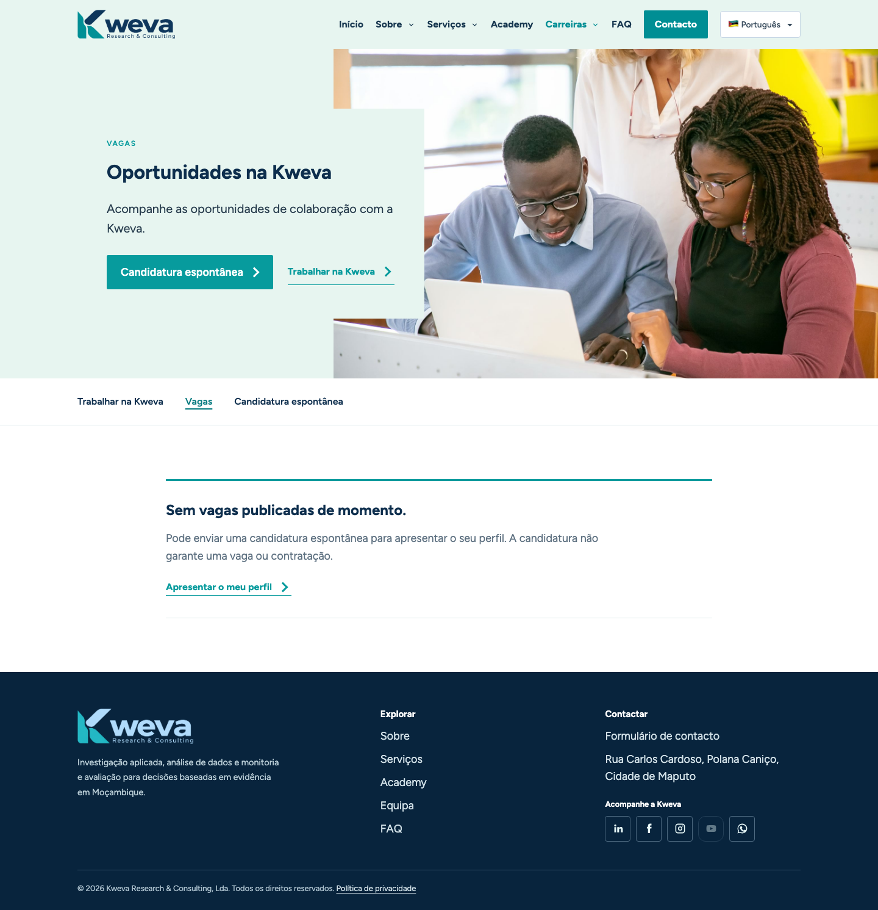
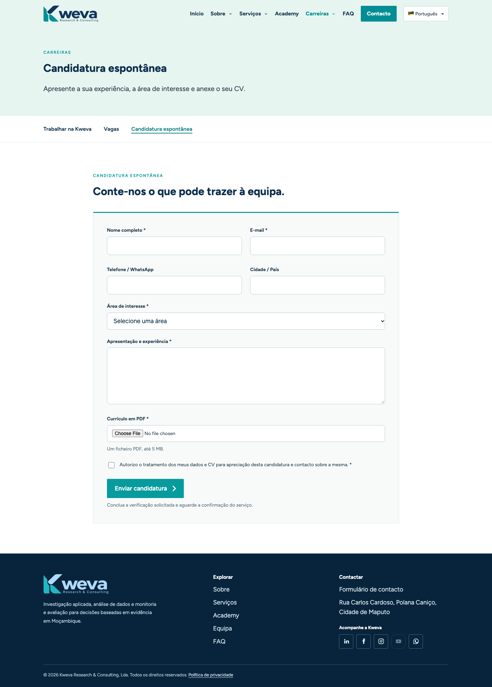
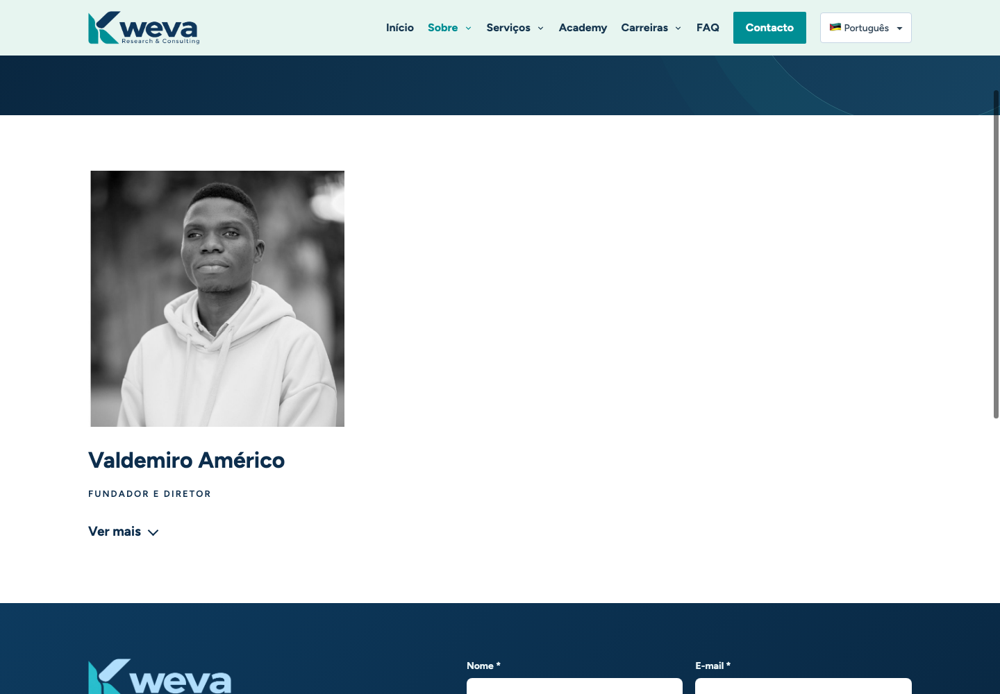

# Revisão editorial Kweva

14 de novembro de 2026. Resultado guardado no código local.

A composição foi revista após comparação direta com a Laterite no Chrome, à mesma largura de 1440 px. O objetivo é aproximar a relação entre tipografia, imagem e espaço, mantendo a identidade, os textos e a estrutura funcional da Kweva.

## Alterações visuais

| Elemento | Antes desta revisão | Resultado |
| --- | --- | --- |
| Título do painel inicial | Até 48 px | 32 px / 40 px no desktop |
| Destaque “Dos dados às decisões” | Até 36 px, alinhado à esquerda | Até 48 px, centrado no desktop |
| Títulos dos três pilares | Até 24 px | 32 px / 40 px no desktop |
| Texto de leitura | 17 px com entrelinha próxima de 30 px | 18 px / 28 px; 16 px no telemóvel |
| Container | 1280 px | 1250 px, com margens internas de 32 px |
| Espaço entre colunas dos pilares | 32 px | 60 px no desktop; adaptação no telemóvel |
| Espaçamento geral entre secções | Até 96 px | 80 px no desktop e 56 px no telemóvel |
| Cards e botões | Cantos de 8–12 px e sombras de repouso | Cantos discretos de 2–4 px; sem sombras de repouso |
| Serviços | Quatro painéis coloridos | Colunas editoriais com separadores, ícones e ações na paleta Kweva |
| Áreas complementares | Fundos e caixas aninhadas | Mais continuidade no branco, linhas discretas e menos decoração |

A Kweva usa agora Figtree em todas as páginas, conservando azul-marinho, turquesa e os seus fundos claros. A Gotham e as imagens da Laterite não foram incorporadas. A fotografia inicial mantém `object-fit: contain`. Todas as secções e funcionalidades existentes foram preservadas.

## Capturas do resultado

## Validação desta revisão

- Chrome com servidor HTTP local, incluindo os dados dinâmicos.
- 17 páginas × cinco larguras: 320, 390, 768, 1024 e 1440 px — 85 cenários sem falhas nos critérios medidos.
- Inglês e navegação nas 17 páginas a 320 e 1101 px — 34 cenários adicionais sem falhas nos critérios medidos.
- Verificados transbordamentos do documento e dos elementos interiores, sobreposições do cabeçalho, caixas de texto, carregamento das imagens, alturas dos cards e alinhamento das ações por linha.
- Verificados menus, submenus, idioma e Escape; perfil da equipa e enquadramento da imagem inicial nas páginas correspondentes.
- Capturas de todas as páginas no desktop; capturas móveis de páginas representativas. Inspeção visual direta do banner, pilares, bloco de apresentação, cards com fotografia e Academy.
- Comparação dos ficheiros HTML antes/depois: textos, links, imagens, controlos e destinos dos formulários preservados.

Safari e Firefox não foram testados. Os formulários não foram enviados e o site não foi publicado.

## Conferência no Live Server e ajuste tipográfico

A versão servida pelo VS Code na porta 5500 corresponde aos ficheiros atuais do projeto. Foi feita uma comparação visual entre Montserrat e Figtree no mesmo navegador, largura e página. Figtree foi aplicada para reduzir a largura aparente e a geometria pesada dos títulos anteriores. O espaçamento entre letras dos títulos passou a zero. O menu desktop passou de 15 px/600 para 16 px/700; o limite de largura do título de apresentação mantém a leitura em duas linhas no desktop.

A verificação desta etapa foi feita diretamente no Live Server existente: 17 páginas em português a 320, 390, 768, 1101 e 1440 px, com conferência adicional em inglês a 320 e 1101 px (119 cenários). Confirmados o carregamento efetivo de Figtree e a ausência de transbordamentos, sobreposições do cabeçalho e textos que excedam a própria caixa nos critérios medidos. Textos, links, imagens e formulários foram novamente comparados e preservados. As capturas acima correspondem a esta versão.

## Correção da diferença entre menu e submenu

Removido o bloco de navegação antigo de `style.css`, que tinha maior especificidade e aplicava 13 px/600 ao submenu. Menu e submenu passam a usar 16 px/24 px, peso 700, na mesma família. Confirmado no Live Server a 390, 1101 e 1440 px, incluindo a fonte efetivamente desenhada por `CSS.getPlatformFontsForNode`: `Figtree-Bold` em ambos.

## Separação entre layout macro e elementos flutuantes

A regra comum de largura exclui menus de navegação, seletor de idioma, diálogos, tooltips e popovers, incluindo os seus descendentes. A largura macro mantém 1250 px. Os dropdowns desktop usam largura por conteúdo, mínimo de 260 px e máximo de 320 px, limitados ao viewport. Itens com padding de 12 × 16 px. Menu de idioma com largura própria de 160–240 px. As transições de abertura/fecho duram 180 ms e respeitam movimento reduzido; o submenu móvel permanece no fluxo do menu expansível.

Verificados no Chrome: três dropdowns em português e inglês a 320, 390, 1101, 1440 e 1920 px; abertura, fecho, limites do viewport e resistência à atribuição acidental da classe `container`. Verificados também o menu de idioma e o modal da equipa a 390 e 1440 px. Os 32 cenários principais passaram.

## Carreiras: páginas independentes

- `carreiras.html`: trabalhar na Kweva e áreas de colaboração.
- `vagas.html`: oportunidades publicadas e indicação de ausência de vagas.
- `candidatura.html`: apresentação e formulário de candidatura, visível diretamente.

O submenu nas 19 páginas aponta para estes três documentos. A navegação local permite alternar entre páginas e identifica a página atual. Os títulos e conteúdos funcionam em português e inglês. As ligações antigas a `carreiras.html#vagas` e `carreiras.html#candidatura` encaminham para as novas páginas.

Verificadas navegações reais pelo submenu em português e inglês a 320, 390 e 1440 px (18 cenários), sem transbordamento. Confirmados os títulos, o estado ativo, o formulário apenas na página dedicada, os redirecionamentos antigos e a validação do CV (extensão PDF e limite de 5 MB). Nenhuma candidatura foi enviada. O formulário multipart original e todos os campos foram preservados.

## Biografia revista com o CV atualizado em português

Fonte: `Valdemiro_Americo_CV_PT.pdf`, fornecido pelo utilizador nesta revisão. A biografia PT/EN passa a refletir a função de Analista de Dados Júnior na IMPACT Initiatives – REACH, em Cabo Delgado, desde outubro de 2026, a experiência anterior em inquéritos e análise de dados e a formação académica indicada no documento. Removida a indicação de mestrado em curso; período académico atualizado para 2025–2026 e licenciatura para 2017–2022. Contacto do perfil atualizado para o primeiro número indicado no CV. Os contactos dos referenciais do currículo não foram incorporados no site.

A apresentação mantém um resumo no cartão e biografia em texto corrido no perfil completo. Verificados os dois idiomas, a leitura do último parágrafo, o contacto e o fecho do modal com retorno do foco, a 390 e 1440 px.

## Estrutura editorial dos cartões da equipa

Cartões simplificados para a sequência fotografia quadrada em escala de cinzentos, nome, função em maiúsculas e ação «Ver mais»/«Read more» com seta para baixo. A fotografia original mantém-se no ficheiro; o preto e branco é aplicado por CSS. Sem moldura ou sombra no cartão. A biografia e os três contactos permanecem no perfil completo, com fecho por Escape e retorno do foco.

Verificados os dois idiomas a 390, 768 e 1440 px: ordem dos elementos, proporção quadrada, filtro visual, ausência de transbordamento e funcionamento do perfil.

